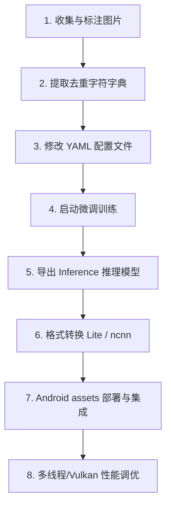

# Slide Deck: Android 移动端 OCR 落地：PaddleOCR 模型微调与场景应用

---

## Slide 1: 封面
### Android 移动端 OCR 落地：PaddleOCR 模型微调与场景应用
* **报告人**：Android 研发团队 / 算法工程组
* **适用对象**：Android 客户端开发工程师 / 嵌入式开发工程师 / 项目技术负责人
* **核心议程**：
  * **痛点剖析**：移动端部署 OCR 的四大核心挑战（体积、内存、发热、倾斜）
  * **原理解析**：通俗讲透文本检测与识别模型，为移动端去掉 RNN 算子
  * **方案对决**：Google ML Kit / Tesseract / EasyOCR / PaddleOCR 优劣对比
  * **实战演练**：打通“数据采集 -> 字典生成 -> 模型微调 -> 转换部署”全流程
  * **性能调优**：FP16 半精度压缩、大小核多线程、Vulkan GPU 硬件加速

---

## Slide 2: 移动端 OCR 的核心挑战与诉求
### 1. 移动端部署的三大“拦路虎”
* **包体积限制**：常规深度学习模型动辄上百 MB，会使 App 肥胖，严重影响下载转化率。
* **内存与 OOM 风险**：移动设备内存受限，OCR 过程如发生内存抖动，极易被系统强杀（Out of Memory）。
* **持续扫码的发热降频**：PDA 扫码枪或工业手持设备在仓库、港口高频扫码时，CPU 持续高负荷运转会导致设备严重发热，进而触发降频保护，导致扫码卡顿、帧率骤降。

### 2. 精度与业务的冲突
* 通用 OCR 识别库在面对特定格式（如车架 VIN 码、特殊工业标签、反光钢印）时，识别率往往不达标。我们需要一种**能够针对特定业务快速定制优化**的方案。

---

## Slide 3: 通俗易懂 —— 深度学习 OCR 是如何工作的？
### 1. 文本检测（DBNet）：找位置的“智能魔棒”
* **传统方式**：用一个矩形方框（如目标检测 YOLO）去套文字。若文字倾斜、弯曲，框里会塞入大量背景噪声，导致识别错误。
* **通俗理解**：DBNet 就像是 Photoshop 里的**智能魔棒/套索工具**。它在像素级别寻找文字的“轮廓边界”。不管是侧向拍摄、弧形排布还是严重倾斜，它都能紧紧贴着文字边缘把它们“抠出来”，再通过仿射变换把它们拉直、切成一行一行的文字小纸条（文本切片）。

### 2. 文本识别（SVTR_LCNet）：读文字的“阅读专家”
* **通俗理解**：它拿到被抠出来的文字行小纸条后，像看书一样，一字一句读取，并将其翻译成电子文本字符串。
* **为什么移动端一定要移除 RNN（循环神经网络）？**
  * RNN 处理数据就像“排队买票”，后一个字必须等前一个字处理完才能开始，无法并发。这在手机的多核 CPU 上非常吃亏。
  * **PP-OCRv4 优化**：移除了 RNN 算子，采用超轻量级的深度可分离卷积（LCNet）和视觉 Transformer 注意力机制（SVTR）。它允许在手机 CPU 上进行多线程并行计算，极大地减少了计算延迟。

---

## Slide 4: 横向对比：主流 OCR 方案的优劣较量

| 维度 | Google ML Kit (On-device) | Tesseract (Tessdata) | EasyOCR (PyTorch) | PaddleOCR (PP-OCR) [本案推荐] |
| :--- | :--- | :--- | :--- | :--- |
| **定位** | 谷歌开箱即用套件 | 传统开源 OCR 老牌引擎 | Python 社区流行 AI OCR | 工业级超轻量 OCR 系统 |
| **部署体积** | 极小（若用 Play 服务甚至 0MB） | 约 20MB ~ 50MB | 很大 (100MB+ 模型) | 极小（可压缩至 **3MB ~ 10MB**） |
| **Android 性能** | 较好，系统兼容度高 | 较差（CPU 密集单线程） | 极差（易 OOM，卡顿严重） | **极佳（ARM 汇编优化/Vulkan加速）** |
| **微调与定制** | **不支持**（黑盒，无法训练） | 极其繁琐且容易过拟合 | 支持，但模型过于笨重 | **非常友好，支持 50 张小样本微调** |
| **倾斜/复杂环境** | 表现一般 | 极脆弱（超15度基本崩溃）| 较好 | **极佳（通过 Cls 方向分类器处理）** |
| **适用场景** | 证件、标准名片等通用识别 | 无 GPU 环境下的标准文字 | 纯服务器端运行 | **移动端/PDA 工业扫码、特定字符微调** |

---

## Slide 5: 什么是“模型微调（Fine-tune）”？
### 1. 通用模型 vs. 垂直业务
* 官方提供的通用模型包含了数万个中英文字符，虽然“博学”，但在面对 VIN 码（17位字母和数字）、工业零件编号等只包含数字和英文字母的场景时，容易因为干扰而把 `0` 认成 `O`、把 `8` 认成 `B`，或者把其他符号误认。

### 2. 微调的“四两拨千斤”
* **不用从零训练**：从零训练一个 OCR 识别模型需要几百万张图片和庞大的显卡集群。
* **迁移学习**：微调是把官方训练好的大模型拿过来作为“底座”（已具备辨识线条、边缘的通用能力），我们只提供 **50~100 张** 我们自己特定业务场景的图片进行“附加学习”。
* **专攻特定字典**：通过限制字符范围（如限制只识别我们定义的字典字符），能将识别率从通用模型的 80% 飙升至 **98% 以上**，且训练只需十多分钟。

---

## Slide 6: 实战篇：PaddleOCR 训练与部署全流程
### Android 开发视角的端到端流水线



---

## Slide 7: 第一步：收集与标注图片
### 1. 采集实际业务场景的“生图”
* 收集 50~100 张实际使用场景中用手机/扫码枪拍摄的真实图片。
* **要包含多样性**：不同的反光、倾斜角度、模糊程度和光照强弱，这会让模型在复杂环境下的抗干扰能力更强。

### 2. 制作 Paddle 格式的标注清单
* 将裁切好的文字行小图放入 `train_data/rec_train`，并建立 `rec_train_list.txt` 标注清单。
* **格式规范**：`图片相对路径` + **`Tab 制表符 (\t)`** + `图片内的真实文本`
  ```text
  rec_train/word_001.jpg	2022050508:50:54
  rec_train/word_002.jpg	14B1C946B162
  rec_train/word_003.jpg	A809C0D3
  ```
* ⚠️ **警告**：路径和文字之间**必须**使用单个 Tab 键分隔，千万不能直接打空格，否则训练程序读取时会报错崩溃。

---

## Slide 8: 第二步：自动提取字符字典
### 1. 为什么需要字典？
* OCR 算法预测出的是一个数字序号（例如：字符索引 25），我们需要拿着这个索引去“查字典”，才知道它对应的真实文字是字母 `A` 还是数字 `8`。

### 2. 一键提取字符集
* 运行 Python 脚本扫描所有的标注文本，自动提取出所有出现的非重复字符：
  ```bash
  python tools/extract_charset.py
  ```
* 运行后将自动生成字典文件（如：`full_charset.txt`）。

### 3. 字典配置的“黄金法则”
* 每行只能写一个字符。
* **字典文件末尾必须多保留一个回车空行**。如果没有最后这行空白回车，字典里最后那个字符将无法被程序加载，从而导致该字符永远识别错误！

---

## Slide 9: 第三与第四步：参数配置与微调训练
### 1. 修改 YAML 配置文件
另存一份配置文件 `configs/rec/rec_vincode_v4.yml`，重点修改以下字段：
```yaml
Global:
  use_gpu: true                            # 开启 GPU 显卡训练加速
  epoch_num: 100                           # 微调仅需 50~100 轮即可快速收敛
  save_model_dir: ./output/rec_vincode     # 权重保存目录
  character_dict_path: ppocr/utils/dict/vincode_full.txt # 我们刚才生成的字典路径

Train:
  dataset:
    name: SimpleDataSet
    data_dir: ./train_data/                # 标注文件里图片路径的前缀目录
    label_file_list: ["./train_data/rec_train_list.txt"]
```

### 2. 启动微调命令
加载官方的预训练权重（如 `best_accuracy.pdparams`），开始微调：
```bash
python tools/train.py \
  -c configs/rec/rec_vincode_v4.yml \
  -o Global.pretrained_model=./pretrain/ch_PP-OCRv4_rec_train/best_accuracy
```

---

## Slide 10: 第五与第六步：推理模型导出与移动端格式转换
### 1. 导出推理模型（Inference Model）
* 训练过程中保存的权重（`.pdparams`）包含了反向传播的梯度、优化器参数等大量冗余信息，体积很大。
* 运行导出脚本，把这些辅助训练的节点“修剪”掉，只保留前向推理算子，体积可以缩减 70%：
  ```bash
  python tools/export_model.py \
    -c configs/rec/rec_vincode_v4.yml \
    -o Global.pretrained_model=./output/rec_vincode/best_accuracy \
    -o Global.save_inference_dir=./output/infer_rec
  ```

### 2. 转换为 Android 引擎识别的格式
* **若使用 Paddle Lite 路线**：
  使用 `paddle_lite_opt` 优化工具，直接转换成单文件、高压缩的移动端专属模型：
  ```bash
  paddle_lite_opt --model_file=inference.pdmodel --param_file=inference.pdiparams --optimize_out=recognize --valid_targets=arm
  # 输出 recognize.nb 文件
  ```
* **若使用 ncnn 路线**：
  ```
  Paddle 模型 ➔ paddle2onnx ➔ ONNX 模型 ➔ onnx-simplifier 简化的 ONNX ➔ onnx2ncnn 转换 ➔ ncnn param/bin
  ```

---

## Slide 11: 第七步：Android 工程集成与跑通
### 1. 静态资源准备
* 将导出的移动端模型（`.nb` 或 `.param/.bin`）与字典文件（`full_charset.txt`）拷贝到 Android 工程的资源目录下：
  `app/src/main/assets/models/recognize/`

### 2. 核心调用逻辑说明
```kotlin
// Android 端 Kotlin 代码伪逻辑
class PaddleOCRService(val context: Context) {
    private var predictor: OCRPredictor? = null

    fun initModel() {
        val config = PredictorConfig().apply {
            modelPath = "models/recognize/recognize.nb" // 指向 assets 路径
            dictPath = "models/recognize/full_charset.txt"
            cpuThreadNum = 4 // 合理设置 CPU 线程数
            cpuPowerMode = CpuPowerMode.LITE_POWER_HIGH // 高性能模式
        }
        predictor = OCRPredictor.create(context, config)
    }

    fun detectAndRecognize(bitmap: Bitmap): String {
        // 1. 调用检测模型定位文字边界并裁剪
        // 2. 将裁剪出的 Bitmap 送入识别 predictor
        val result = predictor?.run(bitmap)
        return result?.text ?: ""
    }
}
```

---

## Slide 12: 移动端性能优化与调优锦囊
### 1. FP16 半精度压缩
* 默认模型是 32 位浮点数（FP32）。在转换模型时开启 FP16 模式，可把模型大小直接**减小 50%**（例如 6MB 压缩到 3MB）。
* 好处：减少了移动端读取模型时的内存带宽压力，运行速度还能提升 10%~20%，且识别准确率几乎无损。

### 2. 合理配置 CPU 推理线程数
* 并非线程数越多越快！Android 手机多是“大小核”架构，建议将线程数设置为 **2 到 4**（绑定到大核）。
* 线程数设置过高会导致线程间频繁上下文切换，并引发 CPU 急剧发热，造成手机降频卡顿。

### 3. Vulkan GPU 加速机制
* 在 Android 部署中（特别是使用 ncnn 框架时），开启 Vulkan 功能，将计算密集型的矩阵卷积交给手机 GPU。
* **最大收益**：CPU 占用率减半，能有效预防 PDA 扫码枪在持续工作时的**发热、烫手、降频**问题。

---

## Slide 13: 问答与技术研讨 (Q&A)

* **讨论要点 1**：我们当前业务场景中，哪类字体的识别率最低？（比如工业钢印、印刷标签、手写体）如何补充微调样本？
* **讨论要点 2**：Android 端性能测试中，冷启动加载模型耗时是多少？如何进行预加载优化？
* **讨论要点 3**：在低配 Android 扫码枪设备上，Vulkan 的兼容性如何？
